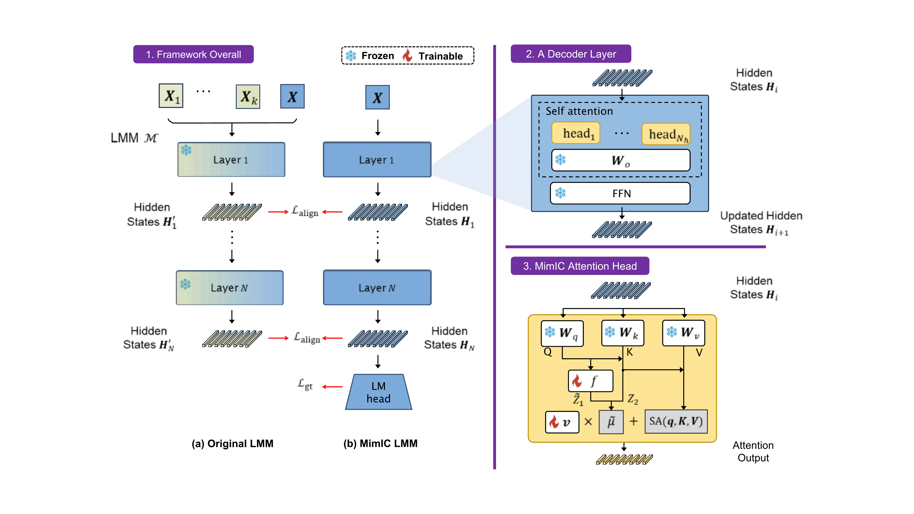

<h1 align="center">Mimic In-Context Learning for Multimodal Tasks</h1>

<p align="center">
<a href="https://arxiv.com/abs/2504.08851">
</a>
</p>




**Mimic In-Context Learning (MimIC)** is a novel framework to adapt vision language models by approximating shift effects from in-context demonstrations. By integrating lightweight learnable modules int models, it demonstrates superior performance compared to previous shift-vector methods and LoRA.

## Setup
### 1. Create environment
The following command can help you build the environment for testing idefics1 and idefics2.
```bash
conda create -y -n mimic python=3.10
pip install -r requirements.txt
```
### 2. Configure paths in `.env`
Copy `.env.example` to `.env`, then fill in the dataset and model paths you actually use. Relative paths are resolved from the repository root.

## How to Run
```bash
cd .
# edit MODE/CKPT_PATH inside the preset launcher, then run it
bash scripts/run_mimic.sh

# entrypoints can also be run directly
accelerate launch --config_file configs/accelerate/zero2.yaml train.py model_name=idefics-9b data.name=vqav2 data.num_query_samples=1000 data.num_shot=16
accelerate launch --config_file configs/accelerate/single_gpu.yaml eval.py ckpt_path=results/ckpt/... model_name=idefics-9b lmms_eval.tasks=vqav2 data.num_shot=16
```

## Code Reading Guides
We would like to introduce some key files to help you understand how MimIC works.
### [`shift_encoder.py`](./src/shift_encoder.py)
In this file, we implemented MimIC attention heads (`AttnApproximator`) and another vector-based method -- [LIVE](https://arxiv.org/pdf/2406.13185) (`AttnFFNShift`).

As we mentioned in paper, self-attention layers are substituted by MimIC attention heads. Such an integration is achieved by replacing `forward` of those self-attention layers in models (see `*_attn_forward` and `register_shift_hooks`). For example, as you can see `idefics_attn_forward`, we do a shift on regular attention output base on key and query of idefics.

In `do_shift` of `AttnApproximator`, we implemented $f(\cdot)$ and $\boldsymbol{v}$ to approximate in-context demonstrations affected terms (Section 3.2).

### [`trainer.py`](./src/trainer.py)
In this file, we implemented the MimIC training module illustrated in Figure 3. `MimicTrainer` prepares batches and calculates losses depending on `model_strategy`. The `model_strategy` describes which types of losses should be calculated. For exmaple, MimIC uses `Strategy.LAYER_WISE_MSE` and `Strategy.LM_LOSS`, which stand for $L_{\text{align}}$ and $L_{\text{gt}}$ (Eq. 6), respectively. To train LIVE, `Strategy.LOGITS_KL_DIV` and `Strategy.LM_LOSS` are used. As to LoRA, only `Strategy.LM_LOSS` should be applied.

We firstly feed in-context demonstrations and query to model to capture hidden states $H^\prime$  from all layers. This is achieved by [`forward_hook`](https://pytorch.org/docs/stable/generated/torch.nn.modules.module.register_module_forward_hook.html), please see `register_record_hook` in `shift_encoder.py` for details. Then, we enable `shift_hook` (introduced in previous section) only feed query to model to obtain shifted hidden states $H$. Finally, layer-wise alignment loss is computed with these hidden states.

## Customization
### Customize new datasets
0. Add the new dataset path to `.env.example` and your local `.env` if needed.
1. Create a new python script in `src/dataset_utils`.
2. Create a new class named `Dataset` and inherit from `src.dataset_utils.interface.DatasetBase`.
3. Implement all abstract methods and some special required attributes (see docstring of `DatasetBase`).

Then you can set `data.name=...` directly, or adjust `DATASETS` for `run_*` bash scripts.

### Customize new model
This could be a kinda complicate.
0. Add the new model path to `.env.example` and your local `.env` if needed.
1. Create your new model wrapper in `src/models`.
2. Specify the loading method in `build_model()` from `src/utils.py`.
3. Global search `idefics` in `trainer.py` and implement corresponding methods.
4. Determine how many epochs to run and when to save in `configs/train.yaml`.

# Recommended Citation
```
@InProceedings{Jiang_2025_CVPR,
    author    = {Jiang, Yuchu and Fu, Jiale and Hao, Chenduo and Hu, Xinting and Peng, Yingzhe and Geng, Xin and Yang, Xu},
    title     = {Mimic In-Context Learning for Multimodal Tasks},
    booktitle = {Proceedings of the Computer Vision and Pattern Recognition Conference (CVPR)},
    month     = {June},
    year      = {2025},
    pages     = {29825-29835}
}
```
